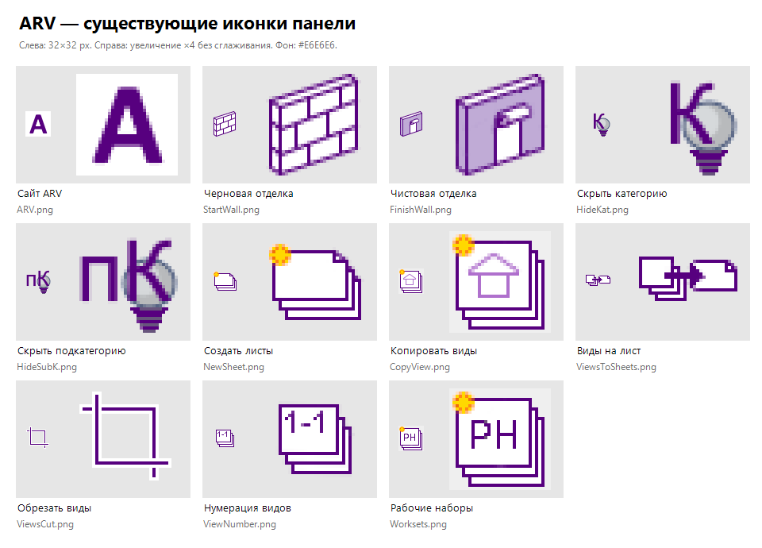

# Иконки ARV: правила оформления

Версия 1.0 · 16.10.2026. Правила для новых иконок и согласованной доработки существующих.

## Характер стиля

Небольшие инженерные пиктограммы: тонкий тёмно-фиолетовый контур, белая внутренняя поверхность, светло-сиреневые грани. Листы изображаются плоско, элементы модели — с небольшим объёмом, как существующие стены. Жёлто-оранжевая звёздочка обозначает создание новых объектов.

Основа — действующий набор панели, а не его перерисованная интерпретация:

На изображении слева показан исходный размер, справа — увеличение ×4 без сглаживания. Для оценки читаемости смотреть прежде всего на маленький вариант. Увеличенные пиксели на этом листе не означают, что новые изображения нужно делать в стиле декоративного pixel art.

## Эталоны

| Элемент | На что ориентироваться |
|---|---|
| Лист, стопка листов, загнутый угол | `NewSheet.png` |
| Изображение вида на листе | `CopyView.png` |
| Перенос/размещение вида | `ViewsToSheets.png` |
| Обрезка, открытые углы | `ViewsCut.png` |
| Цифры на листе | `ViewNumber.png` |
| Контур стены, перспектива | `StartWall.png` |
| Светло-сиреневые грани модели | `FinishWall.png` |
| Создание 3D-видов по рабочим наборам | `Worksets.png` |
| Категория и подкатегория | Пара `HideKat.png` / `HideSubK.png` |
| Логотип сайта | `assets/installed-icons/ARV.png` |

Файлы `Start.png` и `Finish.png` не используются текущими кнопками и не задают палитру новых иконок. В `src/ARV_Ribbon/Images/ARV.png` лежит другой старый вариант логотипа; текущая сборка берёт логотип из `assets/installed-icons/ARV.png`.

## Палитра

Цвета взяты из существующих PNG. Для новых иконок используем следующие опорные значения; промежуточные оттенки допустимы для сглаживания.

| Роль | HEX | Использование |
|---|---|---|
| Основной контур | **`#57007F`** | Внешние линии, стрелки, цифры и буквенные обозначения |
| Белая поверхность | `#FFFFFF` | Бумага, незакрашенная лицевая грань |
| Светлая сиреневая грань | `#C0ABD6` | Второстепенная поверхность модели |
| Сиреневый акцент | `#AF70CD` | Внутренний символ вида, дополнительная грань |
| Жёлтая звёздочка | `#FFD800` | Создание нового объекта |
| Оранжевый край звёздочки | `#FF8617` | Небольшой объём акцента создания |
| Серые вспомогательные поверхности | `#B8BABC`, `#D6D9DB` | При необходимости — детали предметного символа, как у лампочки |
| Приглушённая фиолетовая тень | `#67547C` | Только небольшой вспомогательный объём |

Базовый набор одной иконки: фиолетовый + белый, при необходимости один сиреневый оттенок. Цвета звёздочки добавляются только для создания объектов. Новую собственную палитру для каждой команды не вводим.

## Размер и линии

- Основной холст — **32 × 32 px**. Для SVG — `viewBox="0 0 32 32"`.
- Толщина основного контура — **1 px в конечном размере 32 × 32**. Отдельные акценты могут быть толще, если это уже часть узнаваемого символа.
- Обычный отступ от края — около 2 px. Значок занимает до 28 × 28 px; длинные горизонтальные сюжеты не нужно искусственно растягивать по высоте.
- Важен одинаковый зрительный вес рядом с эталонами. Положение корректируется оптически, а не только по геометрическому центру.
- Между независимыми линиями оставлять по возможности хотя бы 1 px свободного пространства.
- Прямые горизонтальные и вертикальные линии привязывать к пиксельной сетке. Для SVG с обводкой 1 px обычно нужны координаты вида `2.5`, чтобы край не размазывался между пикселями.
- Диагонали и кривые могут иметь аккуратное сглаживание. Размытие и свечение не используются.
- Внешние тени, фоновые плашки, скруглённые цветные квадраты и декоративные рамки не добавляются.
- Объём передаётся геометрией и одной-двумя гранями, как у существующих стен. Фотореалистичность, блики и сложные градиенты не нужны.

Это целевые параметры новых работ. Старые иконки местами отличаются по отступам, оттенкам и способу сглаживания; автоматически подгонять их под стандарт не требуется.

## Смысл и общие обозначения

1. **Один главный объект и одно действие.** Если для понимания нужны несколько объектов, число деталей сокращается до читаемого силуэта.
2. **Один и тот же объект выглядит одинаково в разных командах.** Повторно используем форму листа, загнутый угол, вид и звёздочку из эталонов.
3. **Стопка листов означает множественность.** Двух-трёх смещённых контуров достаточно.
4. **Звёздочка сверху слева означает создание.** Используем для новых листов, копий, новых видов; не ставим её на каждую команду редактирования.
5. **Стрелка означает перенос или применение.** Одно направление, если команда выполняет перенос в одну сторону; начало и результат должны различаться.
6. **Открытые углы означают обрезку.** Ориентир — существующий `ViewsCut.png`, а не новая пиктограмма ножниц.
7. **Категория/подкатегория остаются парой.** Сохраняем общий символ лампочки и различие `К` / `пК`; отдельный стиль для каждой из двух кнопок не вводим.
8. **Подписи под кнопкой объясняют команду; иконка показывает объект и действие.** Длинные слова внутрь пиктограммы не помещаем.
9. **Короткие обозначения допустимы по необходимости.** Например, `К`, `пК`, `РН`, `1–1`. Для кириллицы использовать кириллические символы в исходниках. Перед финальным экспортом SVG преобразовать текст в контуры, чтобы результат не зависел от установленных шрифтов.
10. **Одна иконка не должна обещать другой результат.** Например, «выгрузка файла» и «разместить вид на листе» требуют разных сюжетов даже при общей форме листа.

## Прозрачность и проверка фона

- Внешний фон новых иконок — прозрачный, альфа 0. Белая заливка остаётся только внутри изображённого листа или предмета.
- На полупрозрачную белую подложку вокруг объекта не рассчитываем. В старых `CopyView.png` и `Worksets.png` такая подложка есть; это особенность файлов, которую не следует повторять.
- Проверять изображение на белом, светло-сером `#E6E6E6` и тёмно-сером `#303030` фоне. Цвета при этом не менять: проверяем края и отсутствие прямоугольной подложки.
- Отдельные серые изображения «недоступной кнопки» сейчас не готовим. Доступность команд задаётся кодом панели; визуальное оформление и логика доступности — разные задачи.

## Исходники и экспорт

- Для новых геометрических иконок предпочтителен редактируемый **SVG** без подключённых растров и внешних шрифтов. Если исходник сделан в другом редакторе, сохранить его редактируемый файл вместе с экспортом.
- Итоговый файл для текущей панели — **PNG 32 × 32, RGBA, около 96 DPI**.
- Если понадобится отдельная маленькая кнопка — подготовить **PNG 16 × 16** с упрощёнными деталями. Оценивать его в масштабе 100%; одного автоматического уменьшения может быть недостаточно.
- В текущем коде для `Image` и `LargeImage` используется одна PNG 32 × 32. Добавление отдельной версии 16 × 16 требует явного подключения в коде; само наличие такого файла не меняет панель.
- Названия файлов — короткие английские имена действия и объекта в существующей манере, без пробелов: например, `RenameViews.svg` / `RenameViews.png`. Вариант 16 px — `RenameViews16.png`.
- Новые исходники SVG и PNG хранить рядом в `src/ARV_Ribbon/Images/`. Экспорт всегда получается из сохранённого исходника; PNG не является единственным результатом новой работы.
- Одно имя файла соответствует одной команде. Для замены действующей иконки сохранять её имя, чтобы не потерять связь с кнопкой.

## Как принимать новую иконку

Перед добавлением в выпуск:

- Открыть её рядом с двумя-тремя ближайшими по смыслу эталонами в исходном размере 32 px.
- Проверить, различимы ли объект, действие и отличие от соседней команды.
- Проверить контур, отступы, зрительный размер и прозрачность на трёх фонах.
- Убедиться, что нет слишком мелкого текста, слипшихся линий и случайных точек.
- Проверить размер PNG и наличие редактируемого исходника.
- При подключении команды проверить ссылки в панели, включение ресурса в `.csproj`, список файлов упаковки в `build.ps1` и наличие иконки в готовом ZIP. Действующий скрипт использует явный список имён и не подхватывает новые PNG автоматически.
- После подключения посмотреть фактический размер иконки на панели Revit; просмотр увеличенного PNG сам по себе эту проверку не заменяет.

## Короткое задание для будущего агента иконок

> Создай иконку команды «[название]» для панели ARV в Revit. Команда работает с [объектом] и выполняет [действие]. Сначала изучи `docs/design/ICON_STYLE_RU.md`, лист `ICON_REFERENCE.png` и эталоны [имена ближайших файлов]. Сохрани их фиолетовый контур, белые поверхности, сиреневые грани и инженерную простоту. Холст 32 × 32, контур около 1 px, прозрачный внешний фон; жёлтая звёздочка только при создании новых объектов. Подготовь редактируемый SVG и PNG 32 × 32. Покажи иконку в реальном размере рядом с эталонами. Не изменяй существующие иконки и код команды без соответствующего задания.
