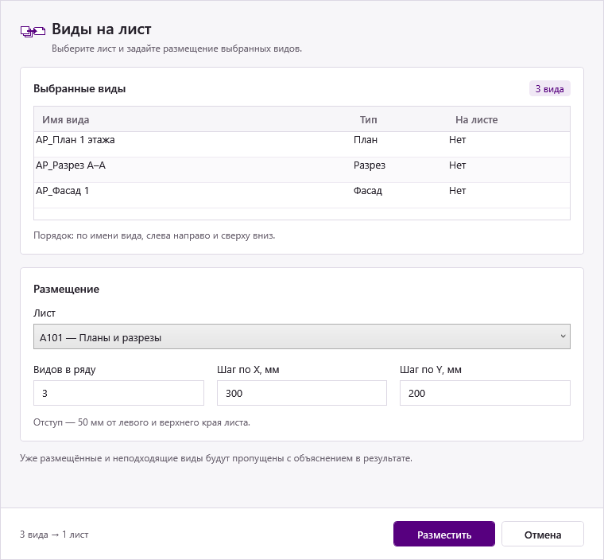

# UI ARV: правила оформления окон

Версия 1.2 · 16.10.2026. Стандарт для окон ARV. В выпуске 1.5.3 тринадцать окон настройки, подтверждения и отчёта используют этот стиль; рабочие стили находятся в ../../src/Common/ArvTheme.xaml. [Галерея](UI_GALLERY.png) показывает их с демонстрационными данными.

## Характер интерфейса

Светлый, спокойный инженерный интерфейс: белые рабочие области, тёмный читаемый текст, тонкие границы и фиолетовый акцент ARV. Действия и данные важнее декоративных элементов. Иконки берём из [стандарта иконок](ICON_STYLE_RU.md).

Одна команда — один понятный сценарий: что выбрано → какие параметры заданы → что будет сделано → фактический результат.



Это **макет будущего оформления**, собранный из WPF/XAML с демонстрационными данными. Это не снимок установленного плагина. Обработчики команд в макете отсутствуют; кнопка не запускает размещение. Стандартная системная рамка и заголовок Windows находятся за пределами показанного макета.

## Цвета

| Назначение | Цвет | Правило |
|---|---|---|
| Акцент ARV | `#57007F` | Основное действие, фокус, активный элемент |
| Наведение основной кнопки | `#6C188F` | Светлее основного фиолетового |
| Нажатие основной кнопки | `#430061` | Темнее основного фиолетового |
| Светлый акцент | `#F0E8F5` | Выделение строки, небольшой счётчик, мягкое выделение |
| Фон окна | `#F7F6F9` | Нейтральная светлая основа |
| Рабочая поверхность | `#FFFFFF` | Поля, таблицы, смысловые блоки |
| Граница | `#DDD8E4` | Тонкие контуры и разделители |
| Основной текст | `#25202A` | Названия, значения и обычные подписи |
| Вспомогательный текст | `#6A626F` | Короткие пояснения и единицы |
| Недоступный элемент | фон `#EEEBF0`, текст `#8A8490` | Состояние недоступности, а не оформление обычного поля |
| Ошибка | `#B42318` | Поле с ошибкой и объяснение рядом |
| Предупреждение | текст `#8C5A00`, фон `#FFF7E0` | Важное ограничение или широкий охват операции |
| Успешный результат | `#276749` | Короткий статус результата, не обычная кнопка запуска |

Цвета состояний не заменяют текст: пользователь должен понимать ошибку или предупреждение без различения оттенков. Жёлтая звёздочка из иконок не становится фоном кнопок. Зелёные кнопки «OK» из старых окон не используем как новый стандарт.

## Шрифты, размеры и отступы

В XAML размеры задаются в **DIP** — логических единицах WPF, а не в физических пикселях экрана. Иконки экспортируются отдельно по своим правилам в px.

| Элемент | Базовый размер |
|---|---|
| Шрифт интерфейса | Segoe UI |
| Основной текст, значения полей | 13 DIP, Regular |
| Короткие пояснения | 12 DIP, Regular |
| Заголовок смыслового блока | 14 DIP, SemiBold |
| Заголовок команды внутри окна | 20 DIP, SemiBold |
| Поле ввода / выпадающий список / кнопка | Минимальная высота 32 DIP |
| Строка таблицы / её заголовок | Обычно 32 DIP, больше при многострочном содержимом |
| Отступ от внешнего края окна | 20–24 DIP |
| Отступ внутри смыслового блока | 16 DIP |
| Между смысловыми блоками | 16 DIP |
| Между подписью и полем | 6 DIP |
| Между соседними кнопками | 8 DIP |
| Внутренний отступ поля по горизонтали | 8 DIP |

Основная сетка отступов: **4 / 8 / 16 / 24**; подпись–поле использует отдельный компактный интервал 6. Радиус блоков и кнопок — до 4 DIP. Плашки-капсулы, большие тени, глянцевые градиенты и декоративная анимация не нужны. Стандартные WPF-контролы не перерисовываем целиком ради скруглений.

## Структура окна

1. **Системный заголовок:** `ARV — Название команды`. Сохраняем обычную рамку Windows, перемещение и стандартное закрытие.
2. **Верхняя часть:** существующая иконка 32 px, короткое название, при необходимости одно предложение о задаче. Не повторяем длинную инструкцию под тем же заголовком.
3. **Выбор объектов:** что взято из Revit, сколько объектов, их понятные имена. Для нескольких десятков объектов — таблица/список с прокруткой.
4. **Параметры:** объединены по смыслу, в порядке заполнения. Связанные числовые поля можно ставить в одну строку, длинные имена — на всю ширину.
5. **Пояснение результата:** если есть нетривиальный порядок, область действия или способ пропуска объектов, обозначить это до запуска.
6. **Нижняя панель:** отделена тонкой линией; основное действие и отмена всегда видны, даже если центральная часть прокручивается.

Не помещаем каждый отдельный элемент в свою карточку. Двух-трёх смысловых блоков обычно достаточно; маленькому диалогу может хватить одной группы без рамки.

## Кнопки и управление

- В окне одно основное действие. Название — глагол с понятным результатом: **«Разместить»**, **«Создать листы»**, **«Копировать»**, **«Пересчитать»** вместо универсального «OK».
- Основная кнопка фиолетовая с белым текстом; вторичная — белая/нейтральная с тёмным текстом и тонкой границей.
- Группа кнопок внизу справа. Порядок для наших диалогов: **основное действие, затем «Отмена»**, как в существующих окнах. Между окнами этот порядок не меняем.
- Минимальная ширина — около 104 DIP; для длинного названия увеличиваем ширину, а не уменьшаем шрифт. Например, «Разместить» в образце имеет ширину не меньше 128.
- Состояния normal / hover / pressed / disabled и клавиатурный фокус должны различаться. Фокус нельзя обозначать только сменой оттенка: оставляем видимую рамку.
- Tab проходит по полям в порядке чтения, затем по действиям. Связь подписи и поля задаётся через Label.Target; подсказка не заменяет подпись.
- Enter запускает основное действие, если пользователь не редактирует многострочный текст или ячейку таблицы. Для подтверждения переноса всего проекта сохраняем безопасное исключение: Enter выбирает «Отмена», перенос запускается явным нажатием «Перенести». Esc закрывает окно настройки без применения изменений. При внедрении подключить соответствующие IsDefault/IsCancel и проверить конфликт с обработчиками клавиатуры.
- Если действие недоступно, рядом должно быть понятно, чего не хватает: «Выберите лист» или «Нет видов для размещения». Не делаем всю форму серой без объяснения.
- Опасное широкое действие подтверждаем текстом с областью влияния, например: «Скрыть категорию во всех видах и шаблонах?». Повторные подтверждения для каждого обычного действия не добавляем.

## Поля и таблицы

- Подпись над полем. Placeholder и tooltip — только дополнение, а не единственное описание поля.
- Единицы указываются в подписи: «Шаг по X, мм», «Коэффициент запаса, %». В самом поле остаётся число.
- Числовой ввод поддерживает точку и запятую; правила диапазона объясняются рядом при ошибке. Пустое значение и ноль не считаются автоматически одним и тем же.
- Поле ошибки сохраняет введённый текст. Объяснение находится под ним и говорит, как исправить: «Введите число больше нуля», а не «Неверные данные».
- Не используем отдельное всплывающее окно на каждую опечатку. Проверяем связанные параметры перед запуском; фокус переводим к первому проблемному полю.
- Имена элементов Revit показываем без самовольного сокращения или изменения регистра. Если имя обрезается по ширине, полное значение доступно в подсказке или при расширении столбца.
- Списки сортируем понятным способом и явно обозначаем этот способ, если от него зависит результат. Для «Видов на лист» это сортировка по «Имени вида».
- Таблица использует спокойный заголовок, тонкие горизонтальные разделители и лёгкое выделение строки. Без тяжёлой чёрной сетки.
- Выделение/галочки не должны обещать несуществующее управление: если пользователь может исключить строки, выполнение действительно учитывает исключение. Если список только показывает исходный выбор Revit, это должно быть понятно по подписи и поведению.
- Пустой список объясняет следующий шаг: «Выберите виды в диспетчере проекта и запустите команду снова».

## Работа и результат

- После запуска нельзя случайно повторить ту же операцию двойным нажатием. Пока команда занята, её кнопка блокируется, а состояние работы видно.
- Для длительной операции показываем этап и счётчик, если это реализуемо: «Обработка 12 из 48». Не рисуем выдуманный процент или прогресс, не связанный с реальной работой.
- Кнопка «Отменить» во время выполнения допустима только при реально реализованной безопасной отмене. Иначе она не должна обещать остановку процесса.
- Результат один на операцию: **«Размещено: 8. Пропущено: 2»**. Для пропусков доступны имена и причины. Не открываем отдельное сообщение на каждый элемент.
- «Успешно» показываем только после подтверждения изменений Revit. При откате не оставляем сообщение об успехе.
- Пользователь видит понятную причину: «Параметр … доступен только для чтения»; стек исключения, названия классов и служебные сообщения не выводим в основной текст. Подробности можно вынести отдельно, если они нужны для диагностики.
- Эмодзи не используем как стандартный способ оформления рабочих сообщений. Для статусов достаточно текста и небольшого подходящего значка.

## Окно, масштабирование и технические границы

- Окно привязано к **текущему сеансу Revit**: перед ShowDialog назначай WindowInteropHelper.Owner = UIApplication.MainWindowHandle из данных запущенной команды. Не ищи первый процесс Revit и не ориентируйся на положение мыши.
- **Все наши окна открываются по центру рабочей области монитора этого сеанса Revit**, даже если основное окно Revit не развёрнуто или сдвинуто вниз. Центр окна Revit и центр экрана — разные точки: CenterOwner для этого правила не подходит.
- Используй общий UiSupport.Initialize(this) и WindowStartupLocation=Manual. Общий помощник определяет монитор по HWND владельца, ограничивает размеры и размещает диалог после расчёта окончательной компоновки (Loaded/ContentRendered). Не добавляй отдельные Left/Top в команды.
- Экранные координаты вычисляй в одной системе Win32; DIP применяй только к компоновке WPF. Учитывай смещение монитора, отрицательные координаты и масштаб Windows. Временный контекст DPI потока обязательно восстанавливай; DPI-режим процесса Revit не меняй. Нельзя центрировать по виртуальному рабочему столу или только основному монитору.
- Ширину выбираем по задаче: примерно 400–480 DIP для маленького диалога, 640–800 для таблицы с настройками. Это ориентиры, не фиксированные размеры всех окон.
- Высота и минимальные размеры учитывают рабочую область монитора в логических единицах. При недостатке места центральная часть прокручивается, нижние кнопки остаются доступны.
- Длинные списки и таблицы допускают изменение размера окна. Отключать resize можно только там, где содержимое действительно компактно и помещается.
- Проверять 100%, 125%, 150% и 200%, длинные русские подписи и небольшой экран. Один красивый рендер не доказывает корректную работу при смене монитора.
- Словарь стилей подключается к **нашим окнам**, не к `Application.Current.Resources` всего Revit. Нельзя случайно перекрасить сам Revit или чужие плагины.
- Пока используется светлая тема. Тёмная тема и системная высокая контрастность требуют отдельной проверки, а не простого инвертирования цветов.
- UI и алгоритм команды изменяются раздельно. При задаче на оформление не менять формулы, область обработки, имена параметров, порядок операций и транзакции без отдельного основания.
- Модель Revit нельзя обрабатывать в произвольном Task.Run ради анимации интерфейса. Контекст API и транзакции — задача реализации команды, а не настройки внешнего вида.

## Файлы образца

- [ArvTheme.xaml](ArvTheme.xaml) — редактируемый пример палитры и стилей основных WPF-контролов. Это отправная точка, не полная готовая библиотека интерфейса.
- [UI_EXAMPLE.xaml](UI_EXAMPLE.xaml) — компоновка «Видов на лист» на демонстрационных данных, без вызовов Revit. Ширины столбцов заданы для этого образца; в рабочем окне они должны учитывать изменение размера.
- [UI_REFERENCE.png](UI_REFERENCE.png), [150%](UI_REFERENCE_144dpi.png), [200%](UI_REFERENCE_192dpi.png) — рендеры одного макета.
- [render-ui-preview.ps1](render-ui-preview.ps1) — воспроизведение рендеров средствами WPF, без открытия окна и без изменения модели.

Запуск из Windows PowerShell в STA:

```powershell
powershell -NoProfile -STA -ExecutionPolicy Bypass -File .\docs\design\render-ui-preview.ps1
```

Загрузка обоих XAML, три демонстрационные строки, существующая иконка и границы основной кнопки проверены программно. Макет отрисован при 96/144/192 DPI и просмотрен визуально. Это проверка макета, не проверка рабочих плагинов или реального переключения DPI в Revit. Макет 125% и высококонтрастная тема в этой работе не проверялись.

## Задание для будущего UI-агента

> Оформи окно команды «[название]» по `docs/design/UI_STYLE_RU.md`. Используй ближайшее по задаче существующее окно и образец `UI_EXAMPLE.xaml`; стили бери из `ArvTheme.xaml`, адаптируя только необходимое. Сохрани названия полей, обработчики, формулы и логику команды. Предусмотри пустое состояние, ошибку ввода, работу и результат. Покажи макет до переноса оформления в рабочий код. При реализации назначь владельца из текущей команды и подключи общий помощник центрирования на мониторе Revit. После переноса проверь компиляцию, компоновку, длинные значения и рендеры при разных DPI без запуска Revit; отдельно укажи выполненные проверки. Команды в Revit пользователь проверяет вручную: подготовь короткий список сценариев, самостоятельно не запускай Revit и не подключайся к нему.


## Как проверяем центрирование

Автоматически без Revit: tests/check-window-position.ps1 проверяет расчёт центра рабочей области, отрицательные координаты, разные размеры в экранных координатах и слишком большое окно. Дополнительно тест использует собственные скрытые окна и проверяет реальный Win32-вызов центрирования при сдвинутом владельце. Он не обращается к окну Revit и не доказывает фактическое положение окна в нём.

Пользователь вручную: открыть любой диалог из текущего Revit на каждом используемом мониторе; проверить с развёрнутым и сдвинутым окном Revit. Ожидаемый результат — центр рабочей области именно этого монитора, весь диалог и кнопки доступны.

Основание реализации: [размещение на нескольких мониторах](https://learn.microsoft.com/en-us/windows/win32/gdi/positioning-objects-on-multiple-display-monitors) [SetWindowPos](https://learn.microsoft.com/en-us/windows/win32/api/winuser/nf-winuser-setwindowpos) и [восстановление DPI-контекста потока](https://learn.microsoft.com/en-us/windows/win32/api/winuser/nf-winuser-setthreaddpiawarenesscontext), Microsoft.

## Компактный отчёт

Для одного результата показывай карточку с ID и переносом полного текста причины вместо большой пустой таблицы. Начальный размер выбирай по содержимому (пример: 620×380 DIP); длинный текст прокручивается, кнопка закрытия остаётся видимой. Для нескольких результатов ограничивай высоту таблицы числом строк и доступной областью экрана. Общие правила владельца и центрирования сохраняются.
